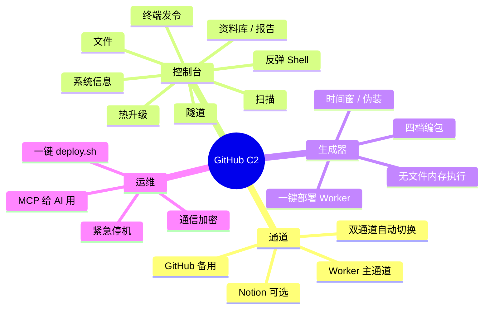
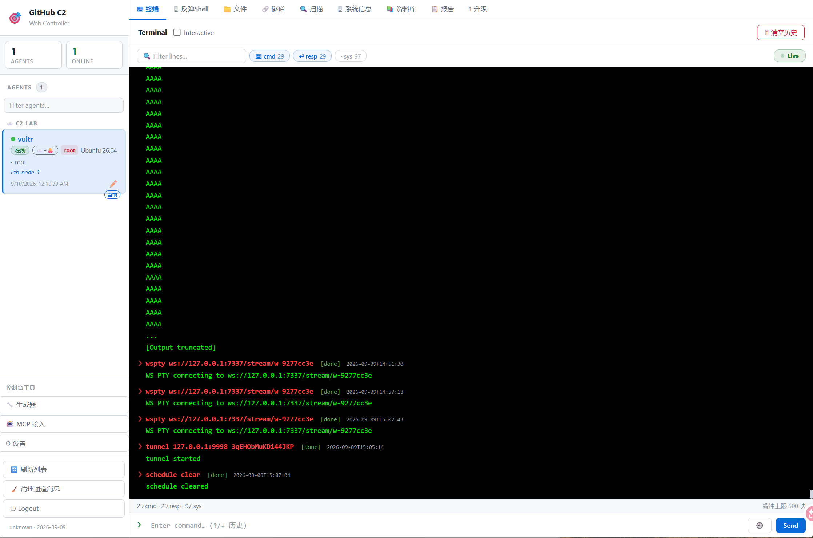
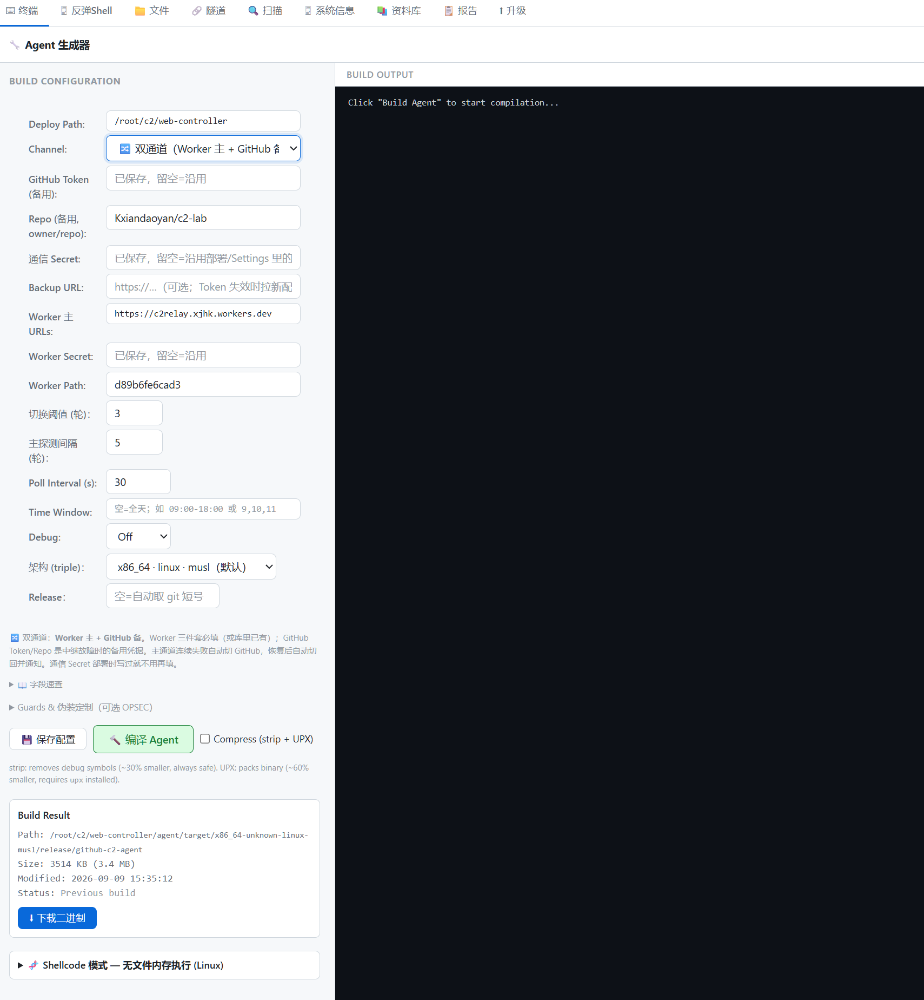

# GitHub C2

网页控制台 + Rust Agent。默认走自己的 Cloudflare Worker 中继，GitHub Issue 当备用。断了自动切，好了自动回来。

> **只用在你自己的机器、授权实验室或红蓝对抗。** 未授权使用他人系统是违法的。本仓库是重构后的交付目录，不含任何个人 Token / 密码。

[English](#english)

---

## 思维导图



---

## 界面

控制台：侧栏看 Agent，上面切功能。终端、反弹 Shell、文件、隧道、扫描、系统信息、资料库、报告、升级都在一个页面。



生成器：网页里选通道、填备用仓库、点编译，直接下载二进制。双通道是 **Worker 主 + GitHub 备**。



---

## 特点（白话）

**通道**

- 四种编包：GitHub / Notion / Worker / 双通道。
- 双通道默认 Worker 当主路（自己的中继，不吃 GitHub 限额），GitHub 当备胎。
- Worker 连败会切到 GitHub；GitHub 上稳定后再探回来。切的时候控制台能看见通知。
- 一台机器两条通道，列表里合成一条，不会当成两台。
- 通信是加密信封，中继库里不落明文主机信息。

**干活**

- **终端**：网页发命令、看回显，可过滤命令/回包/系统消息。
- **反弹 Shell**：真交互 PTY，不是假终端。
- **文件**：浏览、上传、下载。
- **隧道**：目标机拉起 SOCKS，从你这边进内网。
- **扫描 / 系统信息 / 资料库 / 报告**：常见后渗透面板都在。
- **升级**：给已上线的 Agent 热更新。

**编包与隐蔽**

- 网页生成器选架构，可压缩，编完下载。
- 一键把 Worker 中继部署上去，控制台填 URL / Secret / Path 就能用。
- 活动时间窗：只在你定的时段干活。
- 进程名、落地路径可伪装。
- Linux 支持无文件内存执行（shellcode）。

**运维**

- `deploy.sh` 一键装控制器：Python 环境、账号、通信 Secret、systemd。
- 紧急停机（Kill）：所有 Agent 或单个都能停。
- MCP 接口：给支持 MCP 的 AI 工具接同一套控制台。
- 中继库被重建时，水位会自愈，不会永远收不到新命令。
- Token、密码、隧道密钥不会从设置页明文吐回浏览器。

---

## 怎么跑

机器：Linux（Debian / Ubuntu 最省事），要有 Python 3。编 Agent 还要 Rust。

```bash
git clone https://github.com/Kxiandaoyan/github-C2.git
cd github-C2
bash deploy.sh
```

按提示设网页账号和通信 Secret。浏览器打开提示的地址。

双通道建议顺序：

1. 控制台里一键部署 Worker（或自己用 wrangler 部署 `c2/web-controller/cloudflare-worker/`）。
2. 生成器选「双通道」，Worker 三件套填一次，GitHub 备用填真 Token 和仓库。
3. 编译、下载、在目标机跑起来。
4. 侧栏应只看到一条 Agent，主路是 Worker。

纯 Worker、纯 GitHub、Notion 也可以，按生成器那一档编即可。

---

## 不要提交的东西

这些只存在你自己的服务器上，**不要推进 Git**：

- GitHub / Notion Token、网页密码、通信 Secret、Worker Secret
- `.runtime.env`、`*.db`、`venv/`、`agent/target/`、`c2-bundle.tar.gz`
- 编包时写进 `embedded_config.rs` 的真实凭据（仓库里这份是空占位）

本仓库的 `.gitignore` 已挡住常见运行态文件。

---

## English

Web console + Rust agent. Primary path is your own Cloudflare Worker relay; GitHub Issues are the backup. If the relay dies it fails over; when the relay is healthy it fails back.

**Lab / authorized red-team only. Unauthorized access is illegal.** This repo is the rebuilt delivery tree. It ships with no personal tokens or passwords.

### What you get

- Four build profiles: GitHub, Notion, Worker, dual (Worker primary + GitHub backup).
- Dual-channel agents share one row in the sidebar. Commands follow the live channel.
- Encrypted envelopes end to end. The relay does not store plaintext host identity.
- Terminal, interactive PTY shell, files, SOCKS tunnel, scan, sysinfo, library, report, live upgrade.
- In-browser builder: pick arch, optional strip/UPX, download the binary.
- One-click Worker deploy from the console, or wrangler on `c2/web-controller/cloudflare-worker/`.
- Time window, process disguise, Linux fileless/shellcode mode.
- `deploy.sh` installs the controller. Kill-switch for emergencies. MCP for AI tools.
- Settings APIs do not echo secrets back as plaintext.

### Run

```bash
git clone https://github.com/Kxiandaoyan/github-C2.git
cd github-C2
bash deploy.sh
```

Then open the printed URL. For dual-channel: deploy the Worker, fill Worker + real GitHub backup in the builder, compile, run on the target.

### Do not commit

Tokens, web passwords, channel secrets, `.runtime.env`, `*.db`, `venv/`, `agent/target/`, or a bundle built with live credentials.
