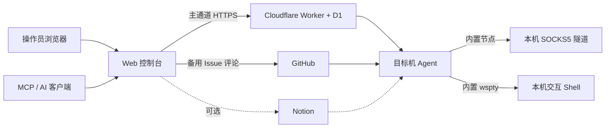
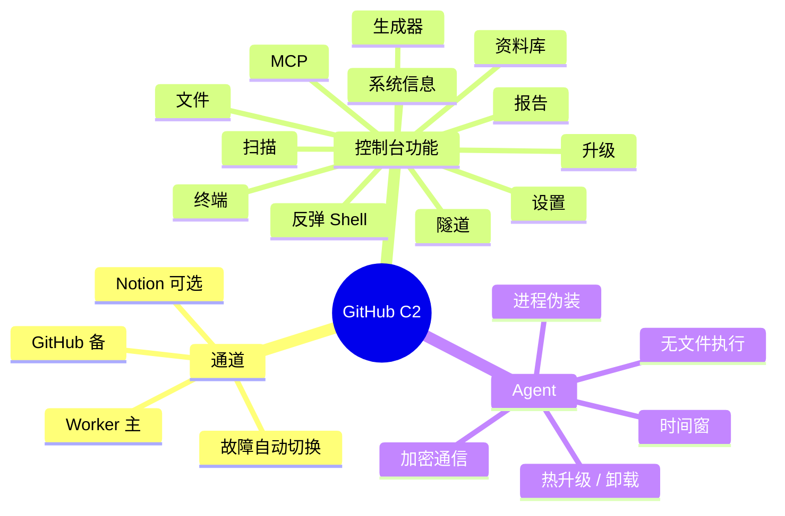

# GitHub C2

授权实验室使用的红队指挥平台。浏览器里管理目标机上的 Agent：发命令、交互 Shell、传文件、穿隧道、扫描、采集、编包、升级。通信默认走你自己的 Cloudflare Worker 中继，GitHub Issue 作为备用通道；主路断了自动切备用，备用稳定后再切回来。

> 仅限你拥有或已获书面授权的环境。未授权侵入他人系统违法。

[English](#english)

---

## 介绍

### 产品定位

GitHub C2 由三部分组成：

| 组件 | 作用 |
|---|---|
| **Web 控制台** | Flask 网页后台。侧栏选 Agent，顶栏切换功能。中文 / 英文界面。 |
| **Agent** | Rust 编写，部署在目标机。轮询取令、加密回传、可持久化与伪装。 |
| **通道** | 把指令和回显搬过去。主通道是 Cloudflare Worker + D1；备用是 GitHub Issue；也可只用 Notion 或只用其中一条。 |

控制台和 Agent 之间的载荷一律是 AES-256-GCM 信封。中继数据库里不存主机明文身份。一台机器若同时挂了 Worker 和 GitHub，侧栏合成一条，不会当成两台。

### 架构





### 界面

侧栏列出已上线的 Agent，顶部切换业务页。终端、反弹 Shell、文件、隧道、扫描、系统信息、资料库、报告、升级在同一工作区。


生成器在网页里选通道、填凭据、编译，完成后直接下载二进制。双通道为 **Worker 主 + GitHub 备**。


---

### 控制台功能

#### 侧栏

- 显示 Agent 总数、在线数；按主机名 / 用户 / 系统 / 备注搜索。
- 每条卡片展示主机、用户、权限、系统、通道徽章（Worker / GitHub / Notion）、最近回显时间。
- 双通道同一台机器只显示一行，点进去两条通道都能用。
- 可给 Agent 写备注（保存在控制台本地库，切换通道不丢）。
- **刷新列表**：主动向已配置的通道拉一次注册信息。
- **清理通道消息**：按设置里的条数 / 过期天数裁剪 GitHub 侧旧评论（中继侧也可清缓冲）。
- **退出登录**。

#### 终端

网页命令行，不是假日志窗。

- 输入命令下发到当前选中的 Agent，回显按块显示。
- **Interactive**：勾选后命令以交互会话方式执行（前缀 `interactive:`）。
- 过滤条：按关键字筛行；cmd / resp / sys 三类可单独开关并计数。
- Live 滚动可暂停，避免长输出把视线带走。
- 上 / 下键翻本机输入历史；历史下拉可重发。
- **清空历史**：清掉该 Agent 在控制台里的会话记录（通道里的旧评论需用侧栏「清理通道消息」）。
- 缓冲上限 500 块，防止超长输出撑爆页面。

#### 反弹 Shell

真交互 PTY，走 WebSocket，不靠 30 秒轮询。

- **服务端**：控制台本机自带的 `cliws`，默认监听 `7337`。点「启动服务端」即可，不必另下软件。
- **目标端**：Agent 内置 `wspty`。点「启动目标端反弹」下发回连，目标机不落额外文件。
- 连上后页面就是 xterm 终端，可直接敲。
- 可改控制端 IP / 端口（Agent 回连地址，防火墙需放行）。
- 历史会话可回看，再切回直播。
- 换选 Agent 时会断开旧会话，避免串台。
- 收工：先停目标端反弹，再停本机服务端。

#### 文件

远程目录浏览器。

- 路径栏、面包屑、快捷目录（`/`、`/tmp`、`/etc`、`/var/log`、`/home`、`/root`、`/dev/shm`）。
- 进目录、回上级、刷新。
- 点文件名按魔数预览：文本、图片、PDF、其余显示十六进制。
- **下载到资料库**：把目标机文件取回控制台本机。
- **上传**：从浏览器传到目标机当前目录（分片下发）。
- **sendit**：大文件经临时中转取回，避免走评论通道的体积限制。

#### 隧道

内网 SOCKS5，基于 Stowaway。

- **服务端**：控制台本机自带 `stowaway_admin`。配置监听端口（默认 9998）和 SOCKS5 端口（默认 1080），点「启动服务端」。
- **目标端**：Agent 内置隧道节点，纯内存，不落文件。填回连 IP / 端口 / Secret，点「启动目标端隧道」。
- 浏览器或代理工具连 `127.0.0.1:SOCKS端口`，即以目标机为跳板进其内网。
- Secret 与设置页隧道密钥一致，页面不回显全文。
- SOCKS 账密可在隧道管理里改（出厂默认仅适合本机 / 内网）。
- 收工：停目标端（停止即清理）+ 停服务端。

#### 扫描

在目标机上下发并运行 [fscan](https://github.com/shadow1ng/fscan)。

- 填写二进制下载 URL，保存后可重复用。
- 参数框写完整 fscan 参数；右侧有常用示例，一点即可填入。
- **下发并运行**：下载到 `/tmp/.san` 后立刻扫。
- **运行**：已有二进制则直接跑。
- **停止**：杀掉扫描进程。
- **清理痕迹**：停进程并删除 `/tmp/.san`。
- **读取结果**：默认 `cat /tmp/r.txt`，输出显示在右侧。

#### 系统信息

- **采集系统信息**：主机、内核、网卡、权限等，带历史快照，可来回看。
- **采集敏感数据**：按目标环境搜集常见敏感路径与凭据痕迹，同样有历史。
- **卸载 Agent**：向当前 Agent 下发卸载（见「卸载」一节）。

#### 资料库

控制台本机上、按 Agent 分开的笔记与文件柜，不经过目标机。

- 新建笔记、新建文件、上传、树状浏览。
- 文本可编辑保存；Markdown 可预览。
- 二进制只能下载，不能在浏览器里改。
- 路径显示在页顶，方便对照磁盘位置。

#### 报告

把该 Agent 的备注、命令历史、回显、系统信息等汇总成一份报告。

- 页内搜索。
- 刷新重新生成。
- 下载 Markdown，便于归档或交接。

#### 升级

给已上线的 Linux Agent 换新二进制，身份（agent id / 通道身份）保留。

1. 在生成器编好新版本，复制下载地址。
2. 填「新二进制 URL」和目标机临时路径（默认 `/tmp/.agent_upg`）。
3. 点 **Download & Upgrade**：Agent 自行下载、校验、替换隐藏路径上的文件、重装持久化、清掉旧 hook，然后重启。
4. 约 30–60 秒后重新出现在侧栏。

也可在目标机已有文件时，直接发 `upgrade <路径>`。升级失败则旧进程继续跑。Windows Agent 请改用手动替换。本页也可下发卸载。

#### 生成器

在控制台本机用 Rust 交叉编译 Agent，编完可下载。

**通道四档**

| 档位 | 行为 |
|---|---|
| GitHub 单通道 | 只走 GitHub Issue 评论。 |
| Notion 单通道 | 只走 Notion 数据库页。 |
| Worker 单通道 | 只走 Cloudflare Worker。 |
| 双通道 | **Worker 为主，GitHub 为备。** Worker 连续失败达到阈值后切 GitHub；备用连续成功后再探主路。 |

**编包字段**

- 通信 Secret：与控制台解密密码相同。部署时写过一次，编包可留空沿用。改了则旧 Agent 全部解不开。
- GitHub Token / 仓库：单 GitHub 或双通道备用时必填真凭据。
- Worker URL、Secret、Path：Worker / 双通道必填；Path 空则中继返回 404。
- 切换阈值 / 主探测间隔：仅双通道，默认 3 轮切备、5 轮探主。
- 轮询间隔：默认 30 秒；有交互会加快，闲置会放慢。
- 时间窗：`09:00-18:00` 或 `9,10,11,14`；空=全天。边界带约 20 分钟抖动。窗外不发包，面板显示安静而非掉线。
- 架构：推荐 `x86_64-unknown-linux-musl`（静态、不依赖 glibc）；另有 aarch64、gnu。
- Release：自定义版本标签，空则用构建时的 git 短号。
- Debug：生产保持关，避免在目标机落日志指纹。
- Backup URL：GitHub Token 失效（401）时，Agent 从该地址拉一份签名过的新配置并重启。空=不启用。
- Guards：可限定主机名、用户、标记文件、最低内存；不满足则静默退出（防沙箱 / 蜜罐）。
- 进程伪装名 / 落地路径：空则按发行版自动扮系统守护进程。
- Compress：strip 去符号；勾选后再用 UPX 压缩（需本机已装 `upx`）。

**无文件模式（Linux）**

- **A · memfd 部署**：生成一条可粘贴到目标机的命令，Agent 在内存里跑，不落盘、不装持久化，重启即无。需要目标机 Python 3.8+。
- **B · 原生 shellcode**：粘贴 hex / `\xNN` / base64，生成 mmap RWX 跳转执行命令。

#### MCP 接入

把控制台交给支持 MCP 的 AI 客户端（stdio）。

- 页面按当前登录态生成说明、能力 JSON、客户端注册 JSON，可一键复制。
- 可下载 `mcp_server.py`。
- 工具分三档（环境变量 `GITHUB_C2_MCP_TOOLS`）：
  - **handoff**（默认）：只列出 Agent。
  - **core**：发命令、读回显、系统信息、统计、列目录、审计、看隧道状态。
  - **full**：再加上传文件、采敏感数据、紧急停机（停机必须确认串 `YES-DESTROY-ALL`）。

页面杀开关已从设置里拿掉，避免误触全灭；需要时走 MCP full 档。

#### 设置

- **GitHub Token**：可加多枚，只显示末四位，轮流使用以减轻限额。
- **控制器解密密码**：加解密指令与回包，与生成器通信 Secret 同步。
- **仓库列表**：控制台扫描 / 发令用的 `owner/repo`。双通道备用仓库会并进扫描列表。
- **Notion**：Token、数据库 ID；可一键给库补齐所需列。
- **Worker**：URL（可多个、逗号分隔）、共享密钥、路径前缀。空字段保存不覆盖；填单独一个 `-` 才清空。
- **轮询间隔 / 评论保留条数 / 过期天数**：控制后台扫描节奏和自动清理。
- **Web 用户名 / 密码**：改控制台登录；改完重启后仍有效。
- **一键部署 Worker**：填 Cloudflare API Token，自动建 D1、建表、上传 Worker、绑密钥、挂每小时清理、打开 workers.dev，并写回设置 / 生成器（第一次会把空的 GitHub 单通道提升为双通道，之后不再擅自改档）。
- **审计日志**：谁在何时对哪台 Agent 做了什么。

空 Token、空密码保存时不会把已有机密覆盖掉。设置页的 GET 接口不把 Secret 全文回给浏览器。

### 通道与可靠性

- 双通道运行时，命令按最近活跃通道走；同一条命令会同时写到兄弟通道，Agent 去重，避免切通道时丢令。
- Worker 连败达到阈值 → 切 GitHub，并在终端可见 `[Channel]` 通知；通知失败则回滚，避免控制台和 Agent 各听一边。
- GitHub 备用上稳定后探 Worker，注册成功再切回，同样发通知。
- 中继 D1 被重建、自增 id 从头计数时，Agent 与控制台会识别水位失效并复位，不会一直收不到新命令。
- 紧急停机（Kill）在活动时间窗外也会检查，避免「下班窗口」里停不下来。

---

## 安装

### 环境

| 项目 | 要求 |
|---|---|
| 控制台主机 | Linux（Debian / Ubuntu 最省事），Python 3，公网或实验室可达 |
| 生成 Agent | 同机需 Rust（`deploy.sh` 可代装 rustup + `x86_64-unknown-linux-musl`） |
| 可选 | `gcc` / `binutils`（链接与 strip）、`upx`（压缩）、Cloudflare 账号（Worker 中继） |
| 目标机 | 按编包架构：Linux musl / gnu，x86_64 或 aarch64 |

随包已带隧道服务端 `stowaway_admin` 和反弹 Shell 服务端 `cliws`，一般不必再下。

### 标准安装

```bash
git clone https://github.com/Kxiandaoyan/github-C2.git
cd github-C2
bash deploy.sh
```

脚本会：

1. 识别源码目录 `c2/`（或旁路的压缩包）。
2. 创建 Python 虚拟环境并安装依赖。
3. 询问（或用参数传入）网页账号、通信 Secret、端口、绑定地址。
4. 把凭据写入 `c2/.runtime.env`（权限 0600）和数据库。
5. 检查隧道 / Shell 二进制；按需安装 Rust 与 musl 目标。
6. 用 systemd 单元 `c2-controller` 拉起控制台（无 systemd 则 5 秒自动拉起）。
7. 做登录 + 接口健康检查；升级失败会回滚上一份快照。

完成后终端会打印访问地址，形如：

```text
http://<服务器IP>:<端口>/?login=<用户名>&pass=<密码>
```

用地址参数登录，页面本身不放登录表单。首次打开后把地址栏里的密码清掉即可。

### 命令行参数

```bash
bash deploy.sh --user admin --pass '你的密码' --c2-secret '通信密钥' --port 8080 --bind 0.0.0.0
```

| 参数 | 含义 |
|---|---|
| `--user` / `--pass` | 控制台登录。重装时回车沿用旧值。 |
| `--c2-secret` | 通信加密 Secret，编包与解密共用。 |
| `--port` / `--bind` | 监听端口与网卡。默认 `8080`、`0.0.0.0`。 |
| `--noninteractive` | 无人值守。密码可用环境变量 `C2_WEB_PASS`。 |
| `--skip-toolchain` | 不装 Rust。生成器将无法编译。 |
| `--skip-always-poll` | 浏览器闲置约 90 秒后停止后台扫描（默认一直扫）。 |
| `--no-systemd` | 不用 systemd，改用脚本循环拉起。 |

无人值守若要顺便装编译链：`C2_INSTALL_TOOLCHAIN=1 bash deploy.sh --noninteractive ...`

### 安装之后

1. 浏览器打开脚本打印的地址，进入控制台。
2. **设置 → Cloudflare Worker 中转**：用 API Token 一键部署中继（或按 `c2/web-controller/cloudflare-worker/README.md` 手动 wrangler）。
3. **生成器**选「双通道」，确认 Worker 三件套和 GitHub 备用 Token / 仓库，点编译，下载二进制。
4. 在授权目标机运行 Agent。侧栏出现一条记录，通道徽章为 Worker + GitHub。
5. 先在终端发一条无害命令确认回显，再使用 Shell / 文件 / 隧道等页。

也可以只编 GitHub、只编 Worker 或只编 Notion，与生成器档位一致即可。

### 升级控制台

在已部署的机器上再次执行 `bash deploy.sh`。回车沿用账号和 Secret。健康检查失败时自动回到升级前的代码和数据库快照。

---

## 卸载

分两层：卸掉**控制台**（你的服务器），以及卸掉**目标机上的 Agent**。

### 卸载控制台

以 root 安装为例：

```bash
# 1. 停服务
systemctl stop c2-controller
systemctl disable c2-controller
rm -f /etc/systemd/system/c2-controller.service
systemctl daemon-reload

# 若当时是普通用户安装：
# systemctl --user stop c2-controller
# systemctl --user disable c2-controller
# rm -f ~/.config/systemd/user/c2-controller.service

# 2. 若没用 systemd
pkill -f 'run-controller.sh --respawn' || true

# 3. 可选：日志轮转
rm -f /etc/logrotate.d/c2-controller

# 4. 删目录（含数据库、虚拟环境、运行时凭据）
# 仓库若在 /opt/github-C2：
rm -rf /opt/github-C2
```

隧道服务端、cliws 随目录一起删除。Cloudflare 上的 Worker / D1 需到 [Cloudflare Dashboard](https://dash.cloudflare.com) 里单独删，脚本不会动你的云账号。

### 卸载 Agent

在控制台打开该 Agent → **系统信息** 或 **升级** → **卸载 Agent**。下发 `uninstall` 后，Agent 会：

1. 拆除持久化（systemd、cron、bashrc、rc.local、用户服务等，视安装时用了哪些）。
2. 拆除已装的隐藏模块（若有）。
3. 删除状态目录里的身份与水位文件。
4. 约 5 秒后删除自身进程文件并退出。

无文件（memfd）模式本来就没有落地文件和持久化，目标机重启即无；仍可下发卸载以结束当前进程。

时间窗外的 Agent 也会检查紧急停机信号。需要一次清掉所有 Agent 时，使用 MCP **full** 档的 killswitch，并传入确认串 `YES-DESTROY-ALL`。

---

## English

Authorized-lab command console. A browser UI drives Rust agents: commands, interactive PTY, files, SOCKS, scanning, collection, builds, and upgrades. Traffic prefers your Cloudflare Worker relay; GitHub Issues are the backup. The agent fails over and fails back by itself.

> Use only on systems you own or are written-authorized to test. Unauthorized access is illegal.

### Introduction

Three parts: a Flask **web console**, a Rust **agent**, and **channels** (Worker + D1 primary, GitHub Issues backup, optional Notion). Payloads are AES-256-GCM. A dual-channel host appears as one sidebar row.

**Sidebar** — search, notes, online count, refresh discovery, prune channel comments, logout.

**Terminal** — send commands, interactive mode, filter cmd/resp/sys, live scroll, local history, clear console history.

**Reverse shell** — bundled `cliws` on the controller, in-memory `wspty` on the agent, xterm over WebSocket, session history, no extra files on the target.

**Files** — browse, breadcrumbs, preview (text/image/PDF/hex), download into the library, upload in chunks, sendit for large pulls.

**Tunnel** — bundled Stowaway admin locally; in-memory SOCKS node on the agent. Point tools at `127.0.0.1:<socks-port>`.

**Scan** — push and run fscan (`/tmp/.san`): deploy, run, stop, wipe, read results.

**System info** — host inventory and sensitive-path collection with snapshots; uninstall the current agent from this page.

**Library** — per-agent notes and files on the controller disk (edit text, preview Markdown, download binaries).

**Report** — searchable Markdown export of notes, history, output, and sysinfo.

**Upgrade** — Linux only: download a new binary, replace the hidden path, reinstall persistence, keep the same agent identity. Failed upgrades leave the old process running.

**Builder** — four profiles (GitHub / Notion / Worker / dual = Worker primary + GitHub backup). Configures secrets, poll interval, time window, arch, guards, process disguise, strip/UPX, HMAC backup URL, memfd deploy, and raw shellcode.

**MCP** — stdio server for AI clients. Toolsets: `handoff` (list only), `core` (command/files/audit/tunnel), `full` (upload, sensitive, killswitch with `YES-DESTROY-ALL`).

**Settings** — GitHub token pool, decrypt secret, repos, Notion, Worker URLs/secret/path, poll/cleanup, web login, one-click Worker deploy, audit log. Empty fields do not wipe stored secrets; GET responses never return full secrets.

Reliability: dual-write on send, visible `[Channel]` notices, rollback if the notice fails, D1 sequence-reset healing, kill checks outside the time window.

### Install

```bash
git clone https://github.com/Kxiandaoyan/github-C2.git
cd github-C2
bash deploy.sh
```

Creates a venv, writes `c2/.runtime.env` (mode 0600), installs Rust/musl when needed, starts `c2-controller` via systemd (or a 5s respawn loop), and health-checks login. Re-run `deploy.sh` to upgrade; a failed health check rolls back.

Flags: `--user` `--pass` `--c2-secret` `--port` `--bind` `--noninteractive` `--skip-toolchain` `--skip-always-poll` `--no-systemd`.

Then: deploy the Worker from Settings, build a dual-channel agent, run it on an authorized host, confirm a terminal echo.

### Uninstall

**Console (root install):**

```bash
systemctl stop c2-controller
systemctl disable c2-controller
rm -f /etc/systemd/system/c2-controller.service
systemctl daemon-reload
rm -f /etc/logrotate.d/c2-controller
rm -rf /path/to/github-C2
```

Delete the Cloudflare Worker/D1 in the dashboard yourself.

**Agent:** System Info or Upgrade → Uninstall Agent. It removes persistence and state, then self-deletes. Memfd agents die on reboot; uninstall still kills the live process. Fleet-wide destroy is MCP `full` killswitch with `confirm=YES-DESTROY-ALL`.
